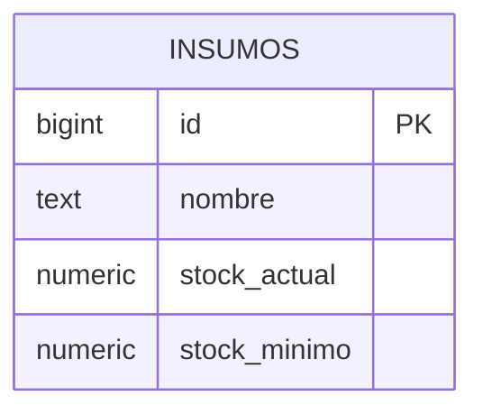

# Cafeter-IA ☕

Una herramienta tranquila para llevar el día a día de una cafetería: revisa existencias, registra bebidas y pide una segunda opinión para planear las compras. La idea es que la operación esté a mano, sin convertir cada tarea en otra cosa que administrar.

## Responsable del proyecto

`HendrixxV2` es el propietario y mantenedor principal del repositorio. El historial de Git conserva la atribución de cada contribución.

## Qué puedes hacer

- **Inventario:** consultar insumos, sus existencias y el nivel mínimo; detectar de un vistazo qué conviene reponer.
- **Punto de venta:** registrar la venta de una bebida. El flujo conectado procesa la operación y descuenta los insumos según la configuración de n8n.
- **Asistente de compras:** solicitar un análisis del inventario y mostrar las sugerencias que devuelve el flujo de IA.
- **Diseño adaptable:** usar las mismas secciones desde escritorio o desde una pantalla pequeña.

## Cómo está armado

El sistema se divide en el frontend, la API, Supabase y los flujos de n8n:

- **Frontend:** React, React Router y Vite. La interfaz vive en `Frontend/src`; Vite sirve el sitio en `http://localhost:5173` y, durante el desarrollo, reenvía `/api` al backend.
- **Backend/API:** Node.js y Express en `Backend/server.js`. Consulta Supabase para el inventario y envía ventas y solicitudes de análisis al webhook de n8n.
- **Base de datos:** Supabase (PostgreSQL) proporciona la tabla `public.insumos`.
- **Automatizaciones:** n8n recibe las acciones `procesar_venta` y `analisis_ia_stock` en el webhook configurado.

## Diagrama entidad-relación

La aplicación consulta la tabla `insumos`. Los productos del punto de venta están definidos actualmente en el frontend y la receta que relaciona cada bebida con sus insumos debe configurarse en el flujo de n8n; no hay tablas de productos, ventas o recetas en este repositorio.



## Levantar la base de datos

La base de datos se aloja en Supabase; no es necesario iniciar PostgreSQL localmente.

1. Crea un proyecto en [Supabase](https://supabase.com/) y espera a que la base de datos esté disponible.
2. En el panel, abre **SQL Editor** y ejecuta este esquema inicial:

   ```sql
   create table if not exists public.insumos (
     id bigint generated by default as identity primary key,
     nombre text not null,
     stock_actual numeric not null default 0,
     stock_minimo numeric not null default 0
   );

   alter table public.insumos enable row level security;

   grant select on public.insumos to anon;

   create policy "Permitir lectura de insumos"
     on public.insumos
     for select
     to anon
     using (true);
   ```

3. Desde **Table Editor**, agrega filas a `insumos` con nombre, stock actual y stock mínimo. El inventario mostrará estos valores.
4. Copia la URL del proyecto y su clave publicable (o `anon`) desde **Project Settings → API**. Configúralas en el backend como se indica más abajo. La clave se mantiene en el servidor, nunca en el frontend.

La política de ejemplo solo permite leer el inventario. Si el flujo de n8n necesita actualizar existencias, configúralo con credenciales de servidor en n8n y permisos adecuados; no expongas una clave `service_role` al navegador.

## Endpoints de la API

Durante el desarrollo, el frontend envía las peticiones a través del proxy de Vite. La API escucha en `http://localhost:3000` por defecto.

| Método | Ruta | Para qué sirve |
| --- | --- | --- |
| `GET` | `/api/insumos` | Devuelve como JSON las filas de `public.insumos`. |
| `POST` | `/api/venta` | Reenvía una venta a n8n. Recibe `{"productoId": 1, "cantidad": 1}` y lo envía junto con `accion: "procesar_venta"`. Devuelve la respuesta del flujo. |
| `POST` | `/api/analisis-ia` | Solicita un análisis a n8n con `accion: "analisis_ia_stock"`; devuelve la respuesta del flujo. No requiere cuerpo. |

La API propaga el código y el cuerpo de error que devuelve n8n cuando falla una venta; por ejemplo, n8n puede devolver `409 Conflict` si no hay existencias. Los errores al consultar Supabase se devuelven como `500`. Si falla la conexión con n8n, las rutas de venta y análisis devuelven `500`.

## Reglas implementadas y responsabilidad de n8n

- **Inventario:** la interfaz marca un insumo como bajo cuando `stock_actual <= stock_minimo`; el cálculo se hace en el frontend y no modifica datos.
- **Punto de venta:** la interfaz ofrece Café Latte (ID 1), Espresso (ID 2), Capuchino (ID 3) y Mocha (ID 4). Cada clic solicita una unidad; mientras se procesa una venta, se bloquean nuevos clics.
- **Stock insuficiente:** si n8n responde con HTTP `409`, la interfaz informa que no hay stock suficiente.
- **Asistente de compras:** solicita el análisis al flujo y muestra `output`, `sugerencia` o, si no existen, la respuesta completa como JSON.
- **Flujo externo:** n8n debe resolver el producto, validar existencias, descontar los insumos según sus recetas y contestar con el estado adecuado. También debe reunir los datos de inventario y generar la respuesta de análisis. Esas recetas, validaciones y reglas no están definidas en el código del repositorio.

## Cómo levantar n8n

1. Inicia una instancia de n8n local (por ejemplo, con Docker):

   ```sh
   docker volume create n8n_data
   docker run -it --rm --name cafeteria-n8n -p 5678:5678 -v n8n_data:/home/node/.n8n docker.n8n.io/n8nio/n8n
   ```

   Mantén esa terminal abierta. La interfaz estará en `http://localhost:5678`.
2. En n8n, crea y activa un workflow con un nodo **Webhook** que acepte `POST` en la ruta `cafeteria-api`. Conecta la lógica para las acciones `procesar_venta` y `analisis_ia_stock`, y responde al webhook con los datos del resultado. Para ventas sin existencias, responde con HTTP `409`.
3. Para `procesar_venta`, el cuerpo contiene `accion`, `productoId` y `cantidad`. Para `analisis_ia_stock`, contiene `accion`. El frontend espera que el resultado del análisis incluya `output` o `sugerencia`, aunque también puede mostrar otra respuesta JSON.
4. Usa la URL de producción del webhook activo en `N8N_WEBHOOK_URL`. En una instancia local, normalmente es `http://localhost:5678/webhook/cafeteria-api`. El webhook de prueba de n8n solo está disponible mientras el workflow está escuchando una ejecución de prueba.

## Preparar y ejecutar el proyecto

Necesitas Node.js, npm, Docker (para el ejemplo de n8n) y un proyecto Supabase configurado.

Desde la raíz del repositorio, instala las dependencias:

```sh
npm --prefix Frontend install
npm --prefix Backend install
```

Copia `Backend/.env.example` como `Backend/.env` y completa los valores:

| Variable | Uso |
| --- | --- |
| `PORT` | Puerto del servidor Express (por defecto, `3000`). |
| `FRONTEND_ORIGIN` | Origen permitido por CORS (por defecto, `http://localhost:5173`). |
| `SUPABASE_URL` | URL del proyecto de Supabase. |
| `SUPABASE_KEY` | Clave publicable/`anon` de Supabase para leer el inventario. |
| `N8N_WEBHOOK_URL` | URL del webhook activo de n8n para ventas y análisis. |

Mantén las claves en `Backend/.env`; no las incluyas en el frontend ni las subas al repositorio.

Levanta los servicios en terminales separadas, en este orden:

1. **Supabase:** comprueba que el proyecto y la tabla `insumos` estén disponibles.
2. **n8n:** inicia la instancia, activa el workflow y confirma que la URL configurada en el backend coincide con el webhook.
3. **Backend/API**, desde la raíz:

   ```sh
   npm run dev:backend
   ```

4. **Frontend**, desde otra terminal en la raíz:

   ```sh
   npm run dev
   ```

Abre `http://localhost:5173`. El inventario depende de Supabase; las ventas y el análisis dependen del workflow activo en n8n.

## Compilar y revisar

```sh
npm run build
npm run lint
```

La compilación del frontend queda en `Frontend/dist`. En producción, configura el servidor que publica el frontend para enviar las rutas `/api` al backend; el proxy de Vite solo aplica durante el desarrollo. El backend se puede iniciar con `npm --prefix Backend start`.

## Estructura

```text
Backend/
  server.js             API Express e integraciones con Supabase y n8n
  .env.example          Plantilla de configuración local
Frontend/
  src/
    components/         Navegación compartida
    pages/              Inventario, punto de venta y asistente
    App.jsx             Estructura y rutas de la aplicación
    index.css           Estilos globales y diseño adaptable
  vite.config.js        Servidor de desarrollo y proxy de la API
```

Que el café fluya; del resto, se encarga una lista clara y un buen flujo de trabajo. ☕
